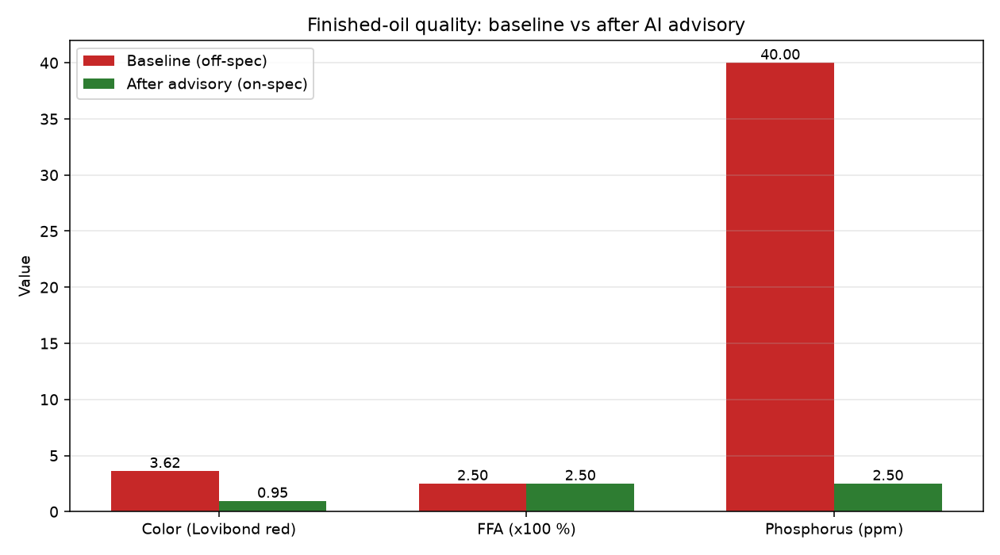
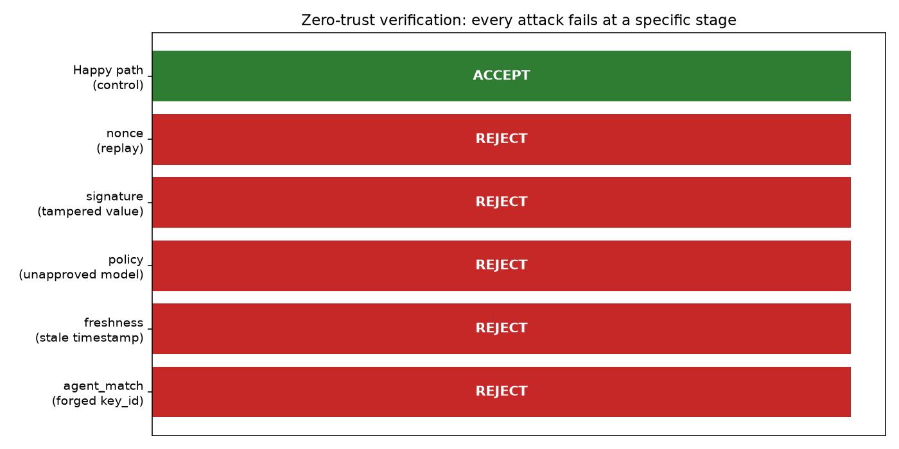
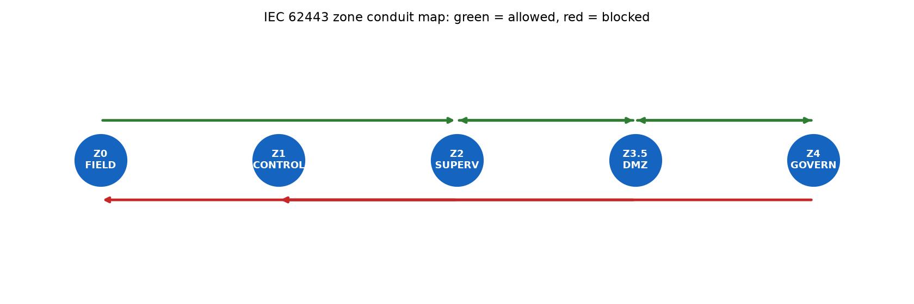
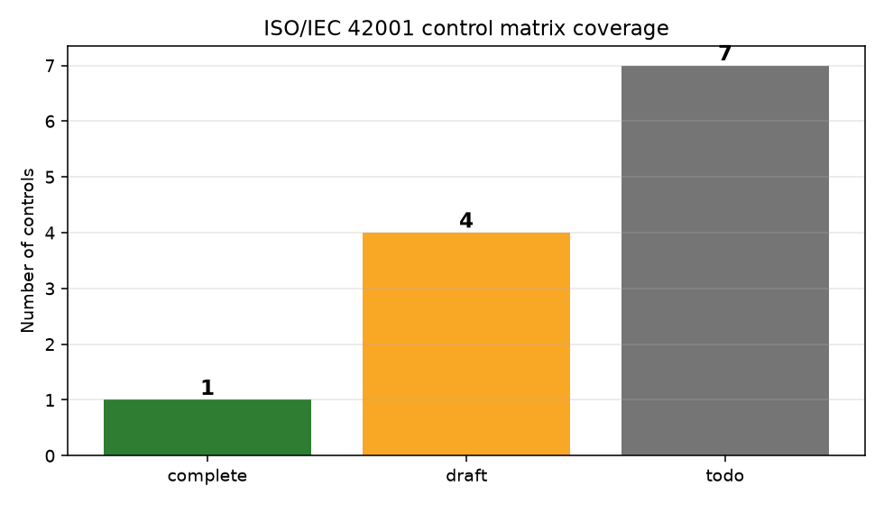

# Trusted Multi-Agent AI Advisory for Vegetable Oil Refining
### A zero-trust OT architecture with signed inference and evidence-based AI compliance

## Two independent enforcement planes

| Plane | Mechanism | Rejects |
|---|---|---|
| **Cryptographic** | Ed25519 + model-version allowlist + nonce store + timestamp skew | forged signatures, replayed envelopes, unapproved models, stale envelopes |
| **Network** | IEC 62443 zone router with explicit conduit matrix | AI-to-PLC, enterprise-to-control, supervisory-to-field |

## Visual evidence

### Baseline vs after advisory

### Attack matrix — every attack fails at a specific stage

### Zone conduit map — IEC 62443

### Compliance coverage — ISO/IEC 42001

Regenerate with `python scripts/generate_charts.py`. See [docs/FIGURES.md](docs/FIGURES.md) for the full visual index.
### Advisory sequence

### Verifier state machine

## Safety boundary

The AI is advisory. It has no write path to the PLC/DCS and is outside the IEC 61511 safety instrumented function. See [docs/SAFETY-BOUNDARY.md](docs/SAFETY-BOUNDARY.md).

## Documentation

- [Executive summary](docs/EXECUTIVE-SUMMARY.md)
- [Architecture](docs/ARCHITECTURE.md)
- [References](docs/REFERENCES.md)
- [Safety boundary](docs/SAFETY-BOUNDARY.md)
- [What is simulated vs real](docs/WHAT-IS-SIMULATED.md)
- [Attack matrix](docs/ATTACK-MATRIX.md)
- [Demo script](docs/DEMO-SCRIPT.md)
- [Portfolio notes](docs/PORTFOLIO-NOTES.md)
- [Figures index](docs/FIGURES.md)

## License

See `LICENSE`.
